# AyudaCampus

**Autor:** Luis Cucho

**Curso:** Programación en Móviles · Laboratorio 08 · TECSUP

AyudaCampus es una aplicación Android para reportar y atender incidencias de TI del campus. Incluye perfiles de Estudiante y Soporte TI, conversaciones por ticket, prioridades, calificaciones y un panel de indicadores. Ambos perfiles comparten la misma base de datos local en el dispositivo y reciben las actualizaciones mediante Flow.

## Tecnologías

Kotlin 2.0.21, Jetpack Compose, Material 3, Navigation Compose, MVVM + Repository, Room 2.6.1, DataStore Preferences, corrutinas, StateFlow y KSP. Interfaz sin XML; los recursos del sistema Android se declaran en el manifiesto y archivos de valores.

- Android Studio con JDK 17 o superior.
- Android SDK 35; dispositivo o emulador Android 7.0 (API 24) o superior.
- Gradle Wrapper 8.9; Android Gradle Plugin 8.7.3.

## Requisitos funcionales

| Código | Requisito |
|---|---|
| RF01 | Iniciar sesión con correo y contraseña, seleccionando Estudiante o Soporte TI; validar campos y coincidencia de rol. |
| RF02 | Recordar la sesión y entrar directamente al perfil activo al volver a abrir la aplicación. |
| RF03 | Mostrar al estudiante únicamente sus tickets, con búsqueda por título o número y filtros por estado. |
| RF04 | Crear tickets con categoría activa, título de al menos 5 caracteres, descripción de al menos 10, ubicación y prioridad; iniciar como ABIERTO. |
| RF05 | Mostrar errores junto a los campos e impedir envíos inválidos o duplicados. |
| RF06 | Mostrar el detalle del ticket, categoría, ubicación, prioridad, estado e historial de atención. |
| RF07 | Permitir comentarios a ambos perfiles mientras el ticket no esté CERRADO; impedir texto vacío. |
| RF08 | Reflejar automáticamente los comentarios y cambios de estado mediante flujos de Room. |
| RF09 | Permitir al estudiante cerrar únicamente un ticket RESUELTO con calificación obligatoria de 1 a 5; guardar fecha de cierre. |
| RF10 | Permitir al estudiante reabrir un ticket RESUELTO y borrar su calificación y fecha de cierre. |
| RF11 | Mostrar a Soporte todos los tickets ordenados por prioridad ALTA, MEDIA y BAJA, y por fecha descendente dentro de cada prioridad. |
| RF12 | Permitir a Soporte filtrar la bandeja por estado y consultar el cliente de cada ticket. |
| RF13 | Permitir a Soporte cambiar estado a ABIERTO, EN_PROCESO o RESUELTO, modificar prioridad y responder. Soporte no puede cerrar tickets ni modificar un ticket CERRADO. |
| RF14 | Mostrar contadores por estado, gráfico de dona y gráfico de barras por categoría. |
| RF15 | Alertar sobre tickets de prioridad ALTA, ABIERTOS y con más de una hora sin atender. |
| RF16 | Crear, editar, activar y desactivar categorías con nombre obligatorio e icono; impedir eliminar categorías utilizadas por tickets. |
| RF17 | Excluir categorías inactivas del formulario de nuevo ticket. |
| RF18 | Mostrar el perfil del estudiante y sus contadores de tickets abiertos, resueltos y totales. |
| RF19 | Cambiar de perfil en modo práctica y limpiar la navegación anterior; permitir cerrar sesión. |
| RF20 | Guardar modo oscuro y preferencias de notificaciones; aplicar el tema inmediatamente y conservarlo al reiniciar. |
| RF21 | Permitir a Soporte abrir o cerrar la recepción de tickets; mostrar “Mesa de ayuda cerrada” e impedir nuevas incidencias si está desactivada. |
| RF22 | Persistir usuarios, categorías, tickets y comentarios en Room; sembrar los datos ficticios una sola vez. |
| RF23 | Ofrecer navegación con tres destinos de Estudiante y cuatro de Soporte, temas cian/violeta y estados vacíos. |
| RF24 | Mostrar el tiempo promedio entre creación y cierre de tickets CERRADOS válidos; actualizar el indicador automáticamente y distinguir ausencia de datos. |
| RF25 | Mostrar SLA por prioridad (Alta 4 h, Media 24 h, Baja 72 h) en tarjetas y detalles, con aviso de vencimiento y mensajes finales para resueltos/cerrados. |
| RF26 | Combinar estado, prioridad, categoría y búsqueda por título, número o estudiante en la bandeja; incluir categorías inactivas y permitir limpiar todos los filtros. |

## Arquitectura MVVM + Repository

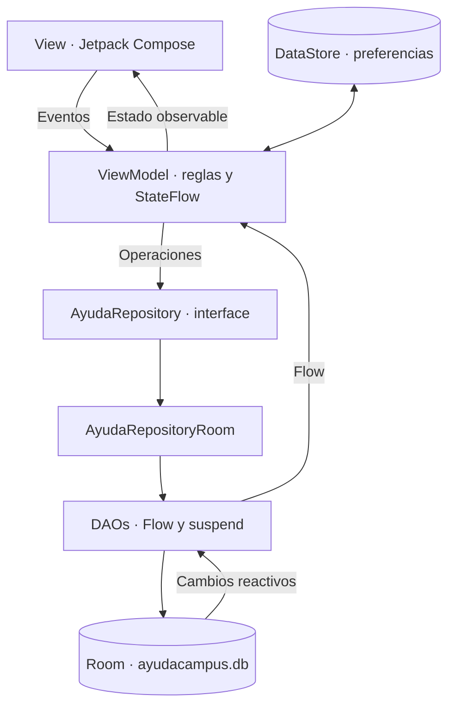

Las pantallas consumen sus ViewModels. Las reglas de negocio se validan en los ViewModels, que dependen del contrato `AyudaRepository`. La implementación de Room conoce los DAOs. Las lecturas reactivas devuelven `Flow`; las escrituras y acciones únicas utilizan `suspend`. `MainActivity` y las fábricas conectan estas dependencias en el punto de entrada.

## Estructura de paquetes

```text
com.tecsup.ayudacampus
├── MainActivity.kt
├── AyudaApp.kt
├── data
│   ├── local
│   │   ├── entity/       Categoria, Usuario, Ticket, Comentario
│   │   ├── dao/          CategoriaDao, UsuarioDao, TicketDao
│   │   ├── relation/     TicketConDetalle
│   │   ├── AyudaDatabase.kt
│   │   └── DatosIniciales.kt
│   ├── repository/       AyudaRepository, AyudaRepositoryRoom
│   └── prefs/            PreferenciasStore
├── model/                Rol, EstadoTicket, Prioridad, ConteoCategoria, DatoGrafico,
│                         PromedioResolucion, SlaTicket, FiltrosBandeja
├── viewmodel/            Sesion, MisTickets, NuevoTicket, TicketDetalle,
│                         Panel, Bandeja, Atender, Categorias y fábricas
└── ui
    ├── theme/            Color, Type, Theme
    ├── components/       Campos, botones, tarjetas, chips, conversación,
    │   │                 stepper, estrellas y utilidades
    │   └── graficos/     GraficoDona, GraficoBarras
    ├── navigation/       Rutas, NavAyuda
    ├── cliente/          Splash, Login, MisTickets, NuevoTicket, Detalle, Perfil
    └── soporte/          Panel, Bandeja, Atender, Categorias, Formulario, Ajustes
```

## Ejecutar el proyecto

1. Clonar el repositorio y abrir su carpeta raíz en Android Studio.
2. Sincronizar Gradle y seleccionar un dispositivo API 24 o superior.
3. Ejecutar la configuración `app`.

```bash
git clone https://github.com/luiscucho-oss/AyudaCampus-LuisCucho.git
cd AyudaCampus-LuisCucho
./gradlew assembleDebug
```

El archivo `local.properties` se genera en cada equipo con la ruta de su SDK y no se incluye en Git.

## Cuentas de práctica

| Perfil | Correo | Contraseña |
|---|---|---|
| Estudiante | `juan@campus.test` | `1234` |
| Soporte TI | `soporte@campus.test` | `admin` |

Los usuarios y credenciales son ficticios para la práctica local. La primera ejecución crea 5 categorías, 2 usuarios, 6 tickets con estados y prioridades variados y 4 comentarios. Cambiar de perfil permite revisar el mismo ticket desde ambos roles. No se requiere servidor ni conexión a Internet para utilizar la aplicación instalada.

## Capturas

Capturas reales obtenidas en el emulador Pixel 4 con Android 16. Los valores del panel corresponden a los datos de la aplicación durante el recorrido de prueba.

| Estudiante: Mis tickets | Estudiante: Nuevo ticket | Estudiante: Detalle |
|---|---|---|
| 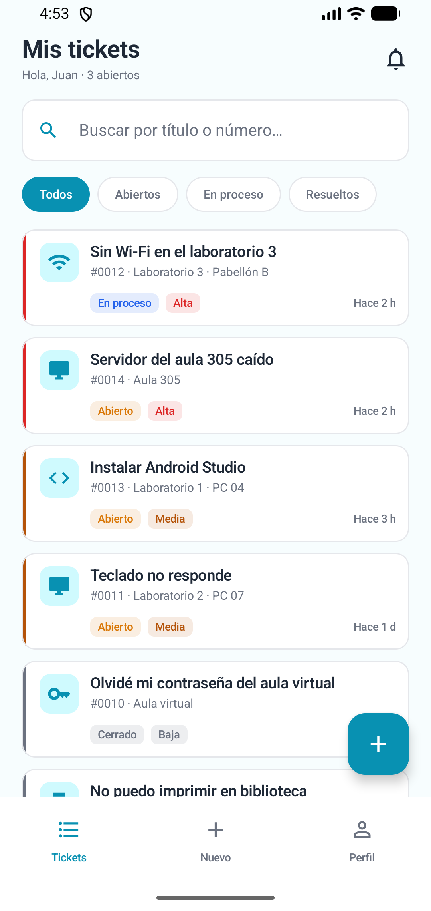 | 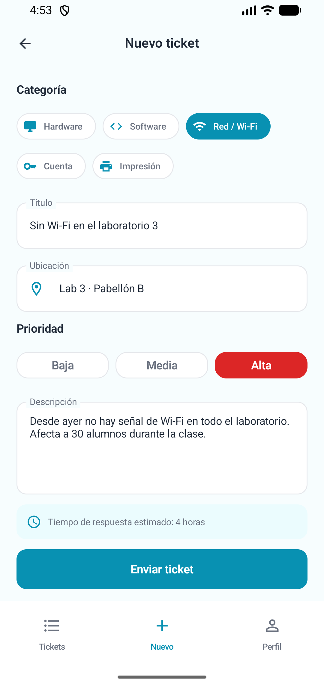 | 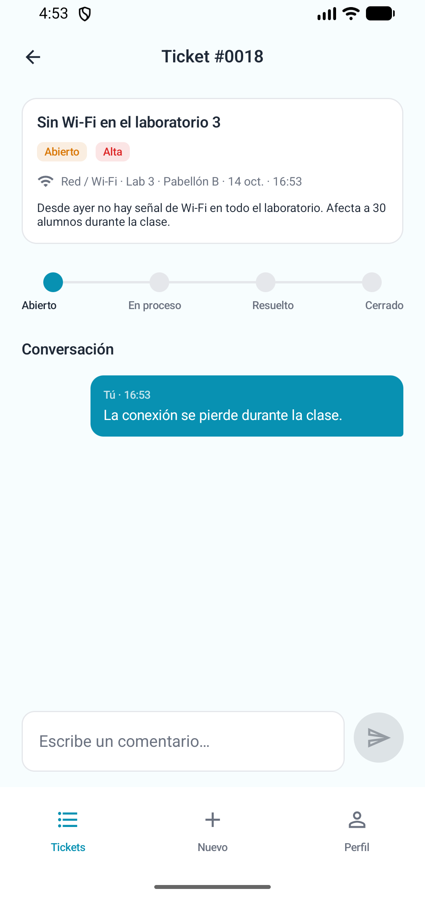 |

| Soporte: Panel | Soporte: Bandeja | Soporte: Atender ticket |
|---|---|---|
| 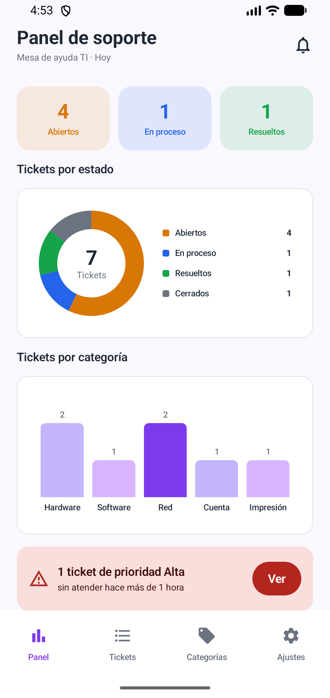 | 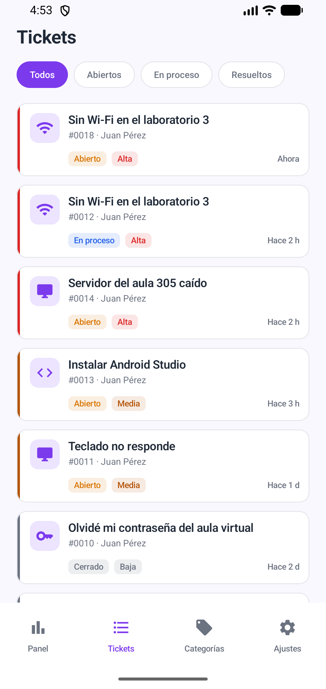 | 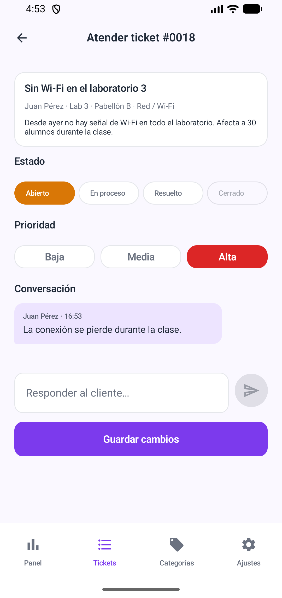 |

## Validación

```bash
./gradlew assembleDebug testDebugUnitTest lintDebug
./gradlew connectedDebugAndroidTest
```

La suite local verifica reglas de tickets, propiedad, permisos de los roles, búsqueda, filtros, categorías y panel. Las pruebas instrumentadas verifican Room, DataStore, sesión, formularios y el flujo completo de la interfaz. El detalle de los resultados se registra en `docs/VALIDACION.md`.

## Para pensar

1. El ViewModel centraliza las reglas; el DAO guarda datos y el Composable solo presenta el estado.
2. `crearTicket` es una escritura única; `observarTicket` emite actualizaciones mediante `Flow`.
3. Sin calificación, el cierre incumpliría la regla y dejaría incompleta la evaluación de la atención.
4. Cambiaría la implementación del Repository para acceder al servidor; conservaría la interface y las pantallas.

## Ramas y mejoras de la segunda fase

`main` conserva la aplicación de la primera fase. `mejora-ia` incluye exactamente tres mejoras de la guía:

| Mejora | Resultado |
|---|---|
| Promedio de resolución | Tarjeta destacada del panel con la media de `fechaCierre - fecha` de los tickets CERRADOS válidos. |
| Contador SLA | Tiempo restante y barra por prioridad en las tarjetas y ambos detalles; aviso en el último 25 % del plazo y al vencer. |
| Búsqueda avanzada | Estado, prioridad, categoría y texto combinados, contador de resultados y limpieza de filtros. |

El SLA se calcula desde la fecha original; cambiar prioridad o reabrir no reinicia su origen. Se actualiza cada minuto mientras la pantalla está observada. Resueltos y cerrados muestran un mensaje final. La búsqueda acepta `#0012`, `12`, títulos o nombres, sin distinguir mayúsculas ni tildes, y conserva el orden por prioridad/fecha del DAO.

Los [prompts y el registro de implementación](PROMPTS.md) incluyen resultados, ajustes, explicación de MVVM y reflexión de cinco líneas. Se conservan también las [plantillas para Gemini en Android Studio](docs/PROMPTS-GEMINI.md). La validación específica está en [VALIDACION-MEJORA-IA.md](docs/VALIDACION-MEJORA-IA.md).

### Capturas reales de mejora-ia

| Panel: promedio | Bandeja: filtros combinados | Detalle: SLA |
|---|---|---|
| 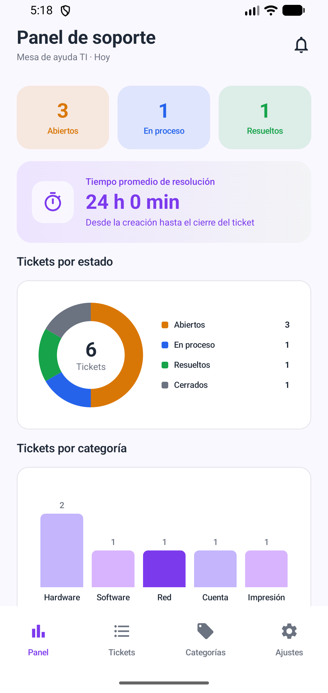 | 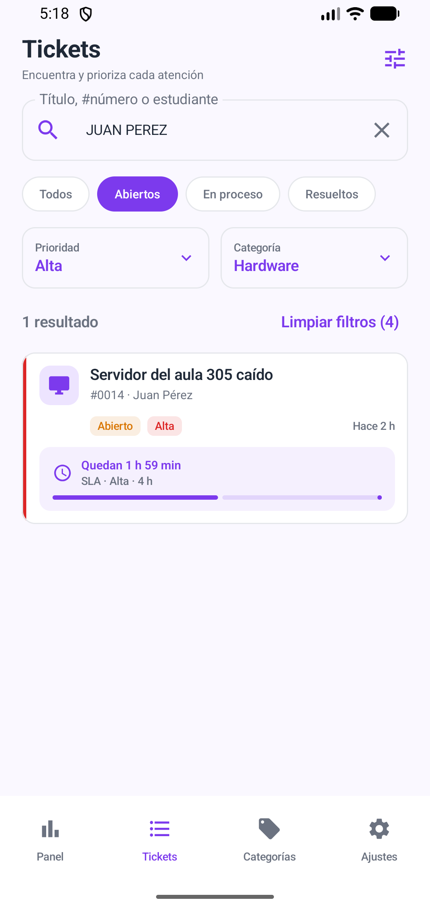 | 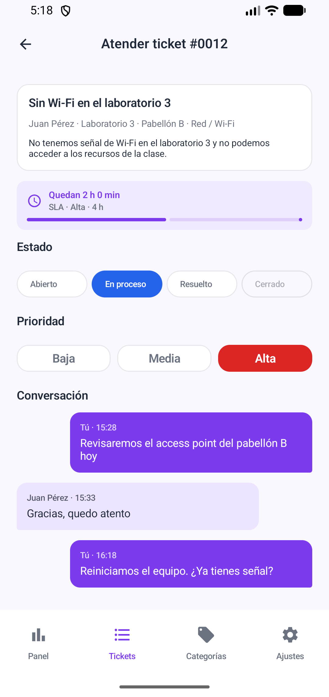 |

| Estudiante: SLA | Tema oscuro |
|---|---|
| 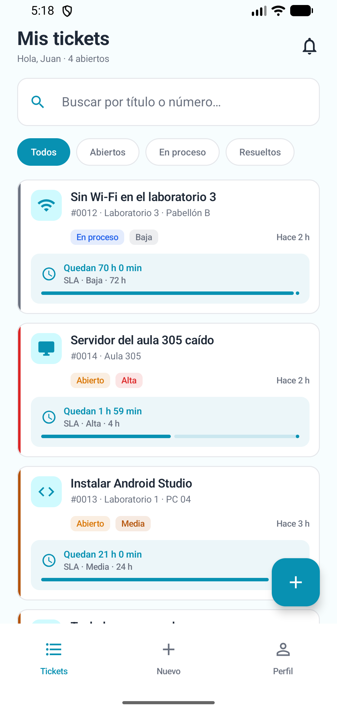 | 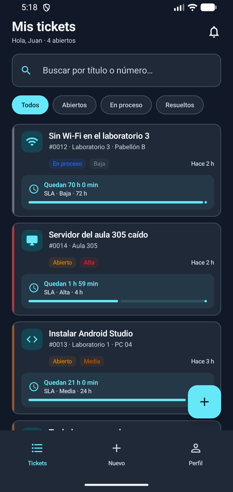 |
